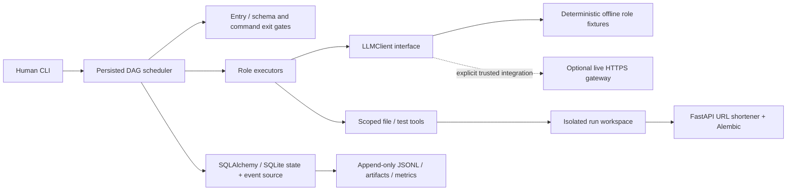
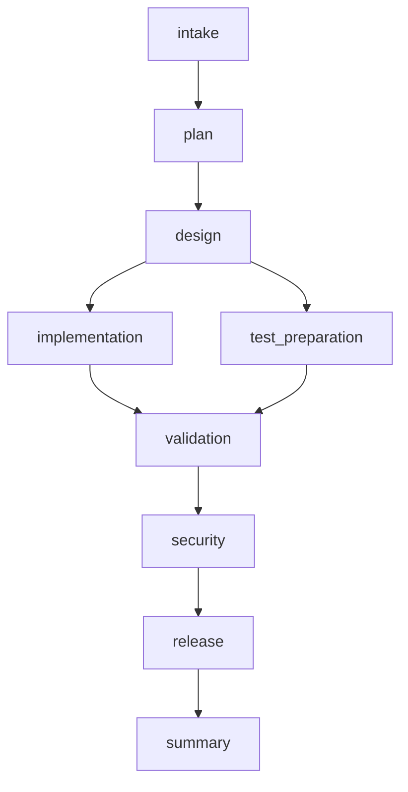
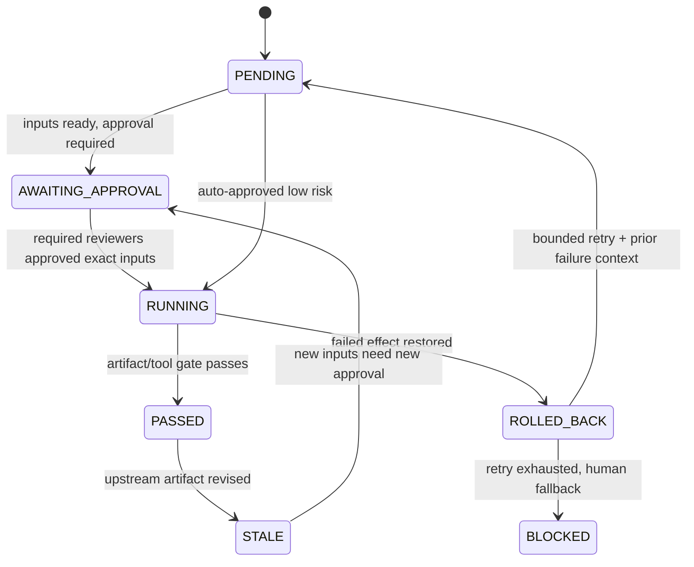

# Architecture and controlled execution



The original S0 executor and its databases remain compatible. Version-2 runs use
new `workflow_tasks` and `workflow_approvals` tables in the same store, reusing
runs, event source, hashing and projection. S0 and v3 share one CLI. Service data
uses a separate migrated database with links, clicks and rate windows.

## Task graph and synchronization



Brownfield inserts codebase_reasoning before plan. Ambiguous inserts clarification
before plan. Each persisted TaskSpec has ID/role/dependencies, risk, max attempts,
file write set, entry/exit criteria, fallback and config. Node rows store status,
input hashes, output/hash, attempt count, failure context and pre-attempt snapshot.
Ready tasks execute in a two-worker ThreadPoolExecutor; joined validation is
ineligible until both branch outputs are PASSED. Concurrent write sets cannot
intersect. Tests use a real thread barrier to prove concurrency independently of
scenario timing. No fake parallel console messages are used.



Failures and rollback transitions are preserved as events; a completed failure
transaction leaves the task either PENDING for retry or BLOCKED for fallback.
Run states include HALTED between atomic waves. SIGINT/SIGTERM request safe-stop;
the CLI halt command records a stop request for a running executor. Resume skips
valid PASSED tasks; interrupted RUNNING tasks restore their persisted file snapshot
before retrying. A real SIGKILL test verifies this policy. Torn JSONL tails still
fail closed; this prototype does not promise automatic recovery at every I/O byte.

## Gates, approvals and policies

The entry gate requires all dependencies PASSED and their schemas/hashes intact.
Approvals bind reviewer, task spec and input hashes, so an upstream revision makes
old approvals ineligible. High risk needs two distinct reviewer names, medium one,
release one. Rejection blocks. Scenario design is high-risk because it governs
authentication, redirect and deletion behavior. Approved template execution is
low-risk within its declared sandbox write set. Real people are never invented:
demo decisions are explicit records with `simulated: true`.

Exit gates validate the artifact envelope with JSON Schema. Validation/security
roles additionally require actual subprocess exit 0; their output records point
to saved command logs. These are practical executable gates, not semantic proofs.
A failed action or exit gate records its exception type and applies verified
compensation to declared files. Failure context goes into the next attempt.
Fallback is human escalation, leaving dependents ineligible. Retry/time/worker
budgets and allowlisted Python modules come from `policy.yaml`.

File tools reject traversal, absolute destinations, protected paths, symlink escape,
undeclared writes and common secret markers. Command tools use argv without a shell,
relative test paths, timeouts, minimized environment and output redaction. No live
network tool is exposed to the demo. Trusted Python tests remain capable of general
code execution: use an OS/container sandbox before accepting untrusted plugins.

## Replanning, audit and metrics

A new upstream artifact hash causes transitive descendants to become STALE;
unaffected passed tasks remain intact. Their approval fingerprints no longer match.
The REPLAN event records old/new hashes and affected IDs. Replanning is proven after
completed downstream work in an engine test and during ambiguous scope revision.

Each state transition and event commits in one SQLite transaction. JSONL is an
append-only projection with prefix verification and recovery of missing committed
records. Event IDs, actor, timestamps, actions, rationale and parent IDs form an
ordered audit chain. Dependency hashes encode artifact lineage back to requirement
fingerprints. Artifact JSON, DAG, approval/state snapshots and metrics are projections.
This is audit-oriented local observability, not tamper-evident external retention.

Metrics derive from actual event timestamps/counts: task attempt success, run
success across observed v3 runs, retries/rollbacks and frequencies, per-gate failures,
per-task/end-to-end latency, failed-to-passed MTTR and approval wait. MTTR is null
without a repair observation. Demo decisions are synthetic; their elapsed waits
are actual timing and do not predict human turnaround.

## Product create / redirect / analytics

```mermaid
sequenceDiagram
  participant C as Client
  participant A as FastAPI
  participant D as SQLite
  C->>A: POST /api/v1/urls + API key
  A->>D: Atomic per-key rate-window update
  A->>A: Validate public HTTP(S) URL / alias / expiry
  A->>D: Unique link insert (retry random-code collision)
  A-->>C: 201 + short code
  C->>A: GET /code
  A->>D: BEGIN IMMEDIATE; check active link
  A->>D: Increment click count + insert timestamp; commit
  A-->>C: 302 Location (301 only explicitly permanent)
  C->>A: Authenticated stats
  A->>D: Check owner; read counters
  A-->>C: JSON statistics
```

Eight base62 CSPRNG characters provide approximately 47.6 bits per generated code.
The database primary key resolves uniqueness; random collisions retry five times,
custom-alias conflicts return 409. Codes are identifiers, not authorization secrets.
302/no-store favors accurate redirect analytics; 301 may be cached and undercount.
SQLite serializes redirect writes for count/event consistency; this limits scale.

References consulted: [SQLAlchemy transactions](https://docs.sqlalchemy.org/en/20/orm/session_transaction.html),
[Alembic tutorial](https://alembic.sqlalchemy.org/en/latest/tutorial.html),
[FastAPI security](https://fastapi.tiangolo.com/tutorial/security/first-steps/).
